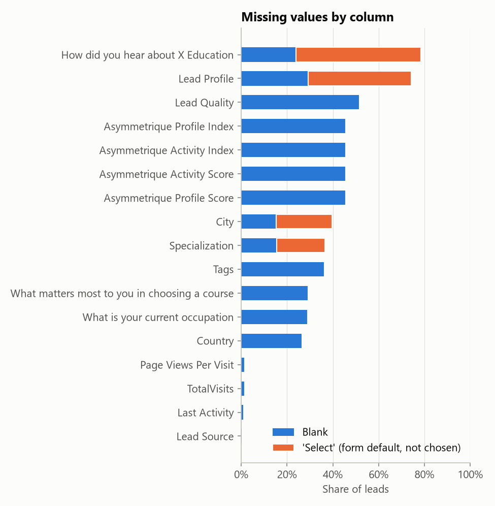
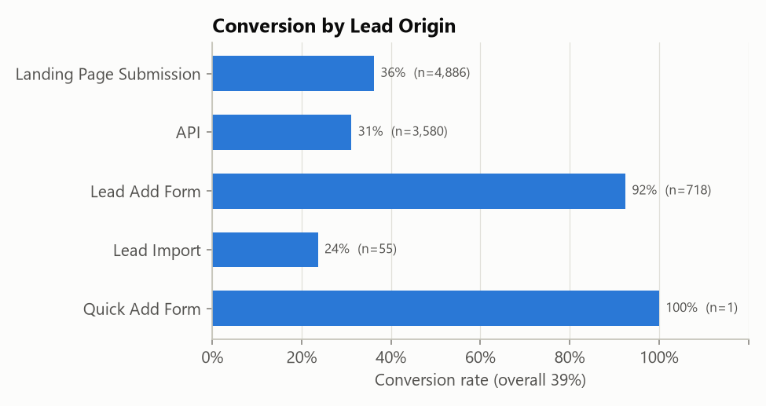
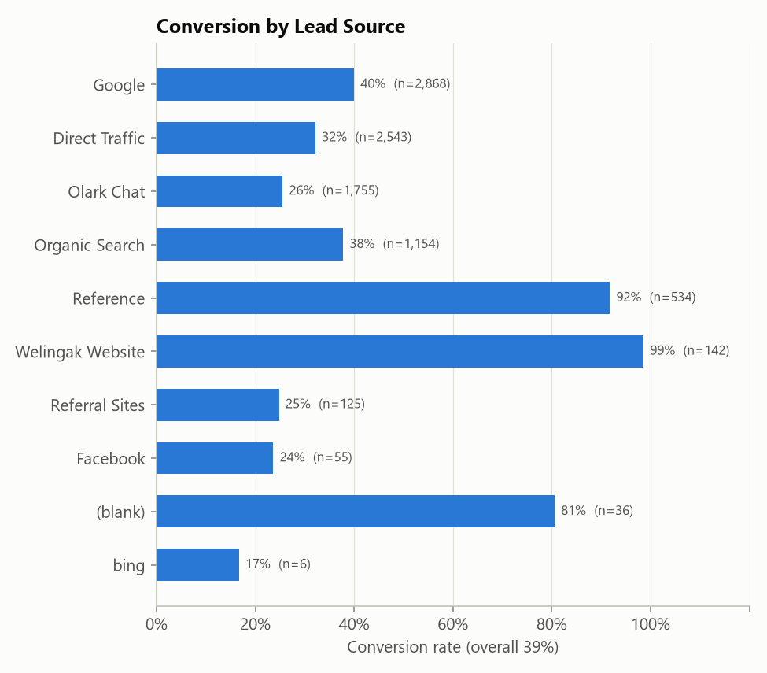
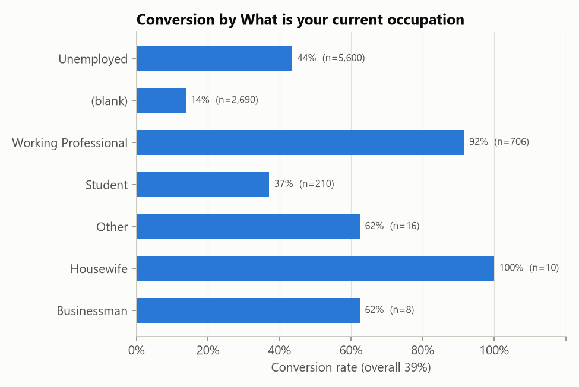
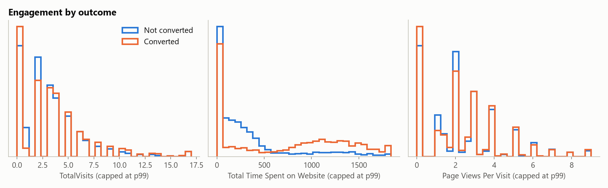
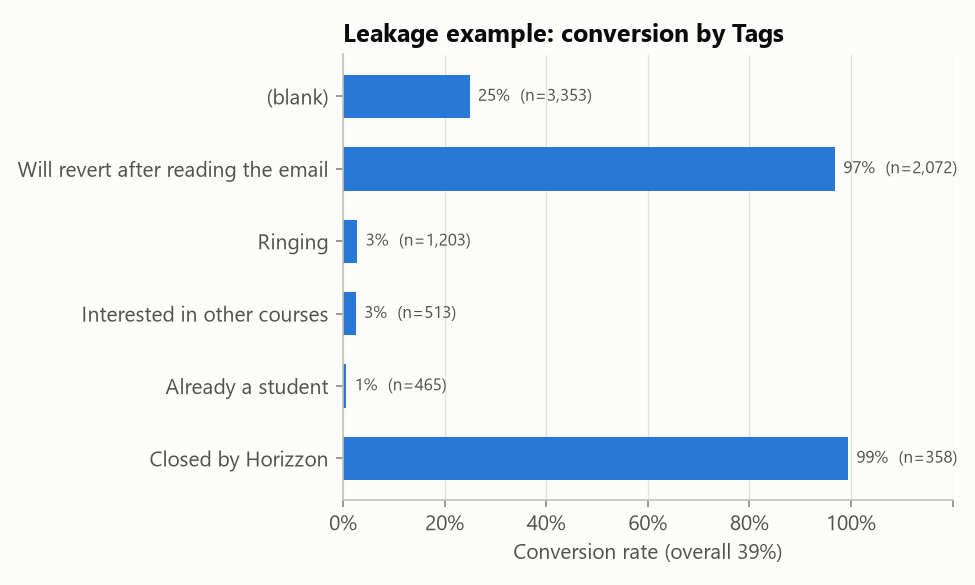

# Agent A: exploratory data analysis

Generated by `python -m lead_scoring.training.eda` from the raw Kaggle file.

## Overview

- 9,240 leads, 37 columns
- Target `Converted`: 38.5% converted, 61.5% not; moderately imbalanced, so
  ROC-AUC / PR-AUC are reported alongside accuracy, and a majority-class baseline is included
  (it scores 61.5% accuracy while finding no converters).
- Duplicate Prospect IDs: 0

## Missing values

'Select' is the form's default option and means the lead did not answer; it is counted as missing.

| index | missing | not selected | missing or not selected |
|---|---|---|---|
| How did you hear about X Education | 23.9% | 54.6% | 78.5% |
| Lead Profile | 29.3% | 44.9% | 74.2% |
| Lead Quality | 51.6% | 0.0% | 51.6% |
| Asymmetrique Profile Index | 45.6% | 0.0% | 45.6% |
| Asymmetrique Activity Index | 45.6% | 0.0% | 45.6% |
| Asymmetrique Activity Score | 45.6% | 0.0% | 45.6% |
| Asymmetrique Profile Score | 45.6% | 0.0% | 45.6% |
| City | 15.4% | 24.3% | 39.7% |
| Specialization | 15.6% | 21.0% | 36.6% |
| Tags | 36.3% | 0.0% | 36.3% |
| What matters most to you in choosing a course | 29.3% | 0.0% | 29.3% |
| What is your current occupation | 29.1% | 0.0% | 29.1% |
| Country | 26.6% | 0.0% | 26.6% |
| Page Views Per Visit | 1.5% | 0.0% | 1.5% |
| TotalVisits | 1.5% | 0.0% | 1.5% |
| Last Activity | 1.1% | 0.0% | 1.1% |
| Lead Source | 0.4% | 0.0% | 0.4% |

## Model inputs

Conversion rate by the categorical inputs (top values):

### Lead Origin

| Lead Origin | leads | conversion_rate |
|---|---|---|
| Landing Page Submission | 4,886 | 36.2% |
| API | 3,580 | 31.1% |
| Lead Add Form | 718 | 92.5% |
| Lead Import | 55 | 23.6% |
| Quick Add Form | 1 | 100.0% |

### Lead Source

| Lead Source | leads | conversion_rate |
|---|---|---|
| Google | 2,868 | 40.0% |
| Direct Traffic | 2,543 | 32.2% |
| Olark Chat | 1,755 | 25.5% |
| Organic Search | 1,154 | 37.8% |
| Reference | 534 | 91.8% |
| Welingak Website | 142 | 98.6% |
| Referral Sites | 125 | 24.8% |
| Facebook | 55 | 23.6% |
| (blank) | 36 | 80.6% |
| bing | 6 | 16.7% |

### What is your current occupation

| What is your current occupation | leads | conversion_rate |
|---|---|---|
| Unemployed | 5,600 | 43.6% |
| (blank) | 2,690 | 13.8% |
| Working Professional | 706 | 91.6% |
| Student | 210 | 37.1% |
| Other | 16 | 62.5% |
| Housewife | 10 | 100.0% |
| Businessman | 8 | 62.5% |

Observations:

- *Lead Add Form* leads convert at ~92% and are the only origin carrying *Reference* and *Welingak Website* sources, so source is nested inside origin.
- *Working Professional* converts at ~92%; a blank occupation converts at ~14%. Blank occupation is tied to the API / landing-page sign-up path (never blank for Lead Add Form), so it is kept as a learned category rather than imputed.

### Engagement

| index | count | mean | 50% | 95% | 99% | max |
|---|---|---|---|---|---|---|
| TotalVisits | 9,103.0 | 3.4 | 3.0 | 10.0 | 17.0 | 251.0 |
| Total Time Spent on Website | 9,240.0 | 487.7 | 248.0 | 1,562.0 | 1,840.6 | 2,272.0 |
| Page Views Per Visit | 9,103.0 | 2.4 | 2.0 | 6.0 | 9.0 | 55.0 |

Heavy right tails (TotalVisits max 251); the model applies log1p and median imputation.

## Target-leakage audit

These columns are recorded by the sales team after contact, so they describe the outcome rather
than predict it. A model using them would look excellent offline and fail on a brand-new lead.

- **Tags**: Sales-rep status recorded after contact ('Will revert after reading the email' converts 97%, 'Ringing' 3%).
- **Lead Quality**: Sales-rep judgement recorded after contact ('High in Relevance' converts 95%, 'Worst' 2%).
- **Lead Profile**: Assigned by the sales team after qualification ('Potential Lead' converts 79%).
- **Last Activity**: Latest touch-point at extraction time, largely sales actions (SMS sent, phone call); unknown when a lead is created.
- **Last Notable Activity**: Same as Last Activity; snapshot at extraction time.
- **Asymmetrique Activity Index**: Scores assigned by the business after profiling; 46% missing.
- **Asymmetrique Profile Index**: Scores assigned by the business after profiling; 46% missing.
- **Asymmetrique Activity Score**: Scores assigned by the business after profiling; 46% missing.
- **Asymmetrique Profile Score**: Scores assigned by the business after profiling; 46% missing.

### Tags

| Tags | leads | conversion_rate |
|---|---|---|
| (blank) | 3,353 | 24.9% |
| Will revert after reading the email | 2,072 | 96.9% |
| Ringing | 1,203 | 2.8% |
| Interested in other courses | 513 | 2.5% |
| Already a student | 465 | 0.6% |
| Closed by Horizzon | 358 | 99.4% |

### Lead Quality

| Lead Quality | leads | conversion_rate |
|---|---|---|
| (blank) | 4,767 | 21.5% |
| Might be | 1,560 | 75.6% |
| Not Sure | 1,092 | 24.4% |
| High in Relevance | 637 | 94.7% |
| Worst | 601 | 2.0% |
| Low in Relevance | 583 | 81.8% |

### Last Activity

| Last Activity | leads | conversion_rate |
|---|---|---|
| Email Opened | 3,437 | 36.5% |
| SMS Sent | 2,745 | 62.9% |
| Olark Chat Conversation | 973 | 8.6% |
| Page Visited on Website | 640 | 23.6% |
| Converted to Lead | 428 | 12.6% |
| Email Bounced | 326 | 8.0% |

