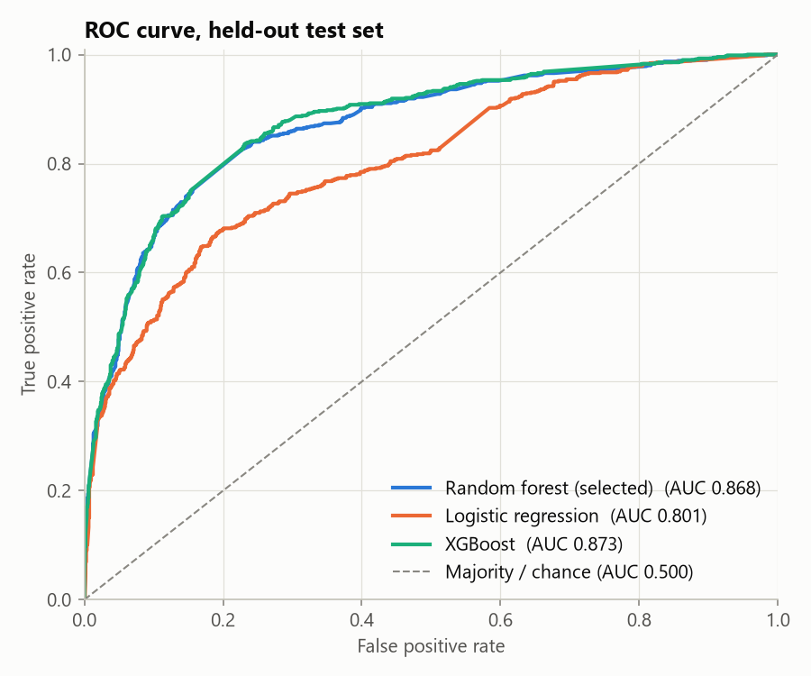
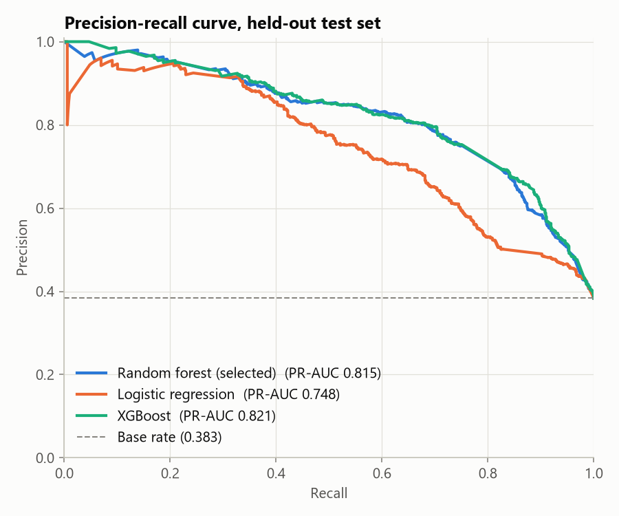
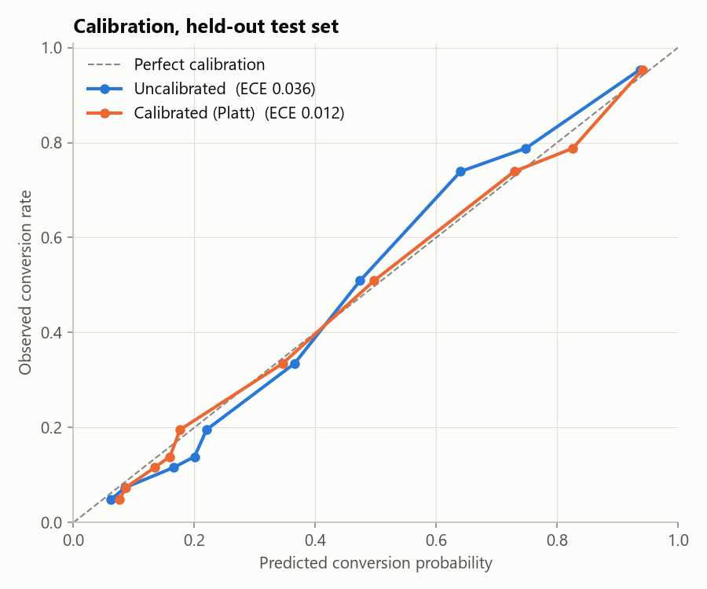
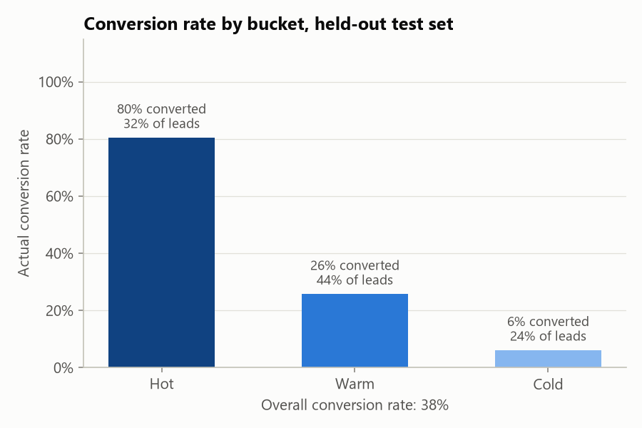
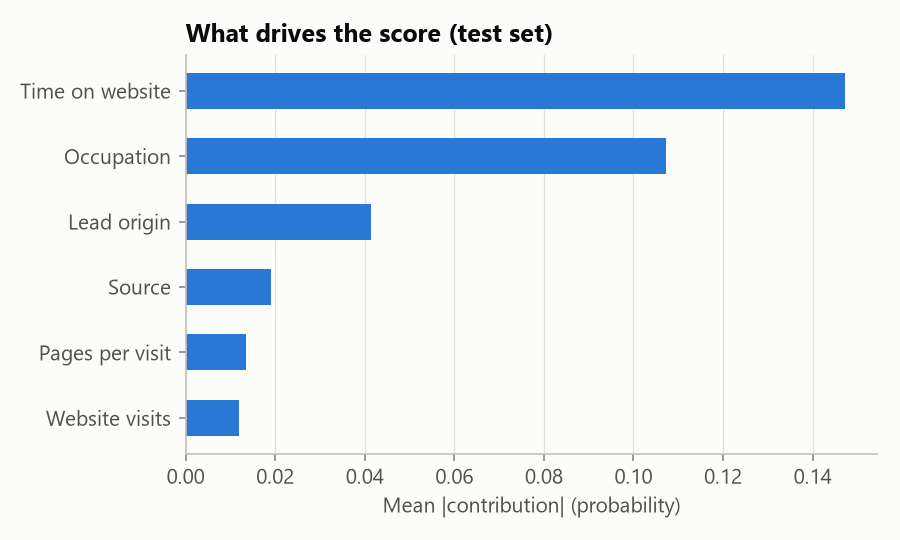

# Agent A: lead-scoring model report

Model version `random_forest-20261027-2a29d5ae`, trained 2026-10-27T15:07:54+00:00.
Generated by `python -m lead_scoring.training.train`; numbers below are on the
held-out **test set**, which was not used for model selection, calibration or thresholds.

## Data

- Source: Kaggle *Lead Scoring X Online Education* (`Leads X Education.csv`, sha256 `1426dffd9424...`)
- 9,240 leads; 9,204 used (38.4% converted)
- Dropped 36 rows with blank Lead Source: In this dataset a blank source marks leads added by hand (81% convert), while in the CRM it only means the field was left empty; keeping them would make 'source not provided' raise the score.
- Split (stratified, seed 42): train 5,522 / validation 1,841 / test 1,841
- Inputs: Lead origin, Source, Occupation, Website visits, Time on website, Pages per visit (only fields known when a lead is created)

Excluded as target leakage (recorded by the sales team after contact):

- **Tags**: Sales-rep status recorded after contact ('Will revert after reading the email' converts 97%, 'Ringing' 3%).
- **Lead Quality**: Sales-rep judgement recorded after contact ('High in Relevance' converts 95%, 'Worst' 2%).
- **Lead Profile**: Assigned by the sales team after qualification ('Potential Lead' converts 79%).
- **Last Activity**: Latest touch-point at extraction time, largely sales actions (SMS sent, phone call); unknown when a lead is created.
- **Last Notable Activity**: Same as Last Activity; snapshot at extraction time.
- **Asymmetrique Activity Index**: Scores assigned by the business after profiling; 46% missing.
- **Asymmetrique Profile Index**: Scores assigned by the business after profiling; 46% missing.
- **Asymmetrique Activity Score**: Scores assigned by the business after profiling; 46% missing.
- **Asymmetrique Profile Score**: Scores assigned by the business after profiling; 46% missing.

## Model comparison

Cross-validated on the training split (5-fold ROC-AUC); the simplest model within 0.005 of the best is selected.

| Model | CV ROC-AUC | Best parameters |
|---|---|---|
| Logistic regression | 0.805 ± 0.021 | `{'C': 1.0}` |
| Random forest | 0.872 ± 0.012 | `{'max_depth': 6, 'min_samples_leaf': 1}` |
| XGBoost | 0.873 ± 0.012 | `{'learning_rate': 0.03, 'max_depth': 3, 'min_child_weight': 1, 'n_estimators': 400}` |

**Selected: Random forest**, calibrated with Platt scaling on the validation split.

## Test-set results

Classification metrics use a 0.5 probability cut-off; ROC-AUC, PR-AUC and Brier are threshold-free.

| Model | Accuracy | Precision | Recall | F1 | ROC-AUC | PR-AUC | Brier |
|---|---|---|---|---|---|---|---|
| Majority-class baseline | 0.617 | 0.000 | 0.000 | 0.000 | 0.500 | 0.383 | 0.383 |
| Logistic regression | 0.754 | 0.772 | 0.508 | 0.613 | 0.801 | 0.748 | 0.168 |
| Random forest | 0.813 | 0.800 | 0.681 | 0.736 | 0.868 | 0.815 | 0.138 |
| XGBoost | 0.815 | 0.795 | 0.697 | 0.743 | 0.873 | 0.821 | 0.136 |
| **Selected (calibrated)** | 0.814 | 0.801 | 0.684 | 0.738 | 0.868 | 0.815 | 0.137 |

- ROC-AUC 95% CI (bootstrap, 1,000 resamples): 0.852 – 0.884
- ROC-AUC gain over the logistic-regression baseline, 95% CI: +0.051 – +0.081
- Calibration error (ECE): uncalibrated 0.036, calibrated 0.012

 

## Hot / Warm / Cold

Cut-offs chosen on the validation split: **Hot** when score ≥ 0.630 (lowest cut-off keeping precision ≥ 80%); **Cold** when score < 0.136 (at most 5% of converters fall below it).

| Bucket | Leads | Share of leads | Actual conversion | Share of all conversions |
|---|---|---|---|---|
| Hot | 583 | 31.7% | 80.4% | 66.4% |
| Warm | 816 | 44.3% | 25.7% | 29.7% |
| Cold | 442 | 24.0% | 6.1% | 3.8% |

## Explanations

Each score comes with its top 3 factors, from exact per-lead contributions (TreeSHAP), e.g.
`Occupation: Working Professional (raises score)`. Overall importance:

## Serving rules

- Missing numeric inputs are imputed with the training median and are not cited in top_factors.
- A missing lead origin or source is filled with the most common training value (neutral) and is not cited in top_factors; a missing occupation is a learned category ('not provided').
- Categories never seen in training (e.g. source 'Event') are encoded as an infrequent category, never an error.
- If occupation is missing but the job title maps to a seniority level, occupation is taken as 'Working Professional' (shown as '(from job title)').
- Consent is not a model input; the consent layer decides what may be done with a lead.
